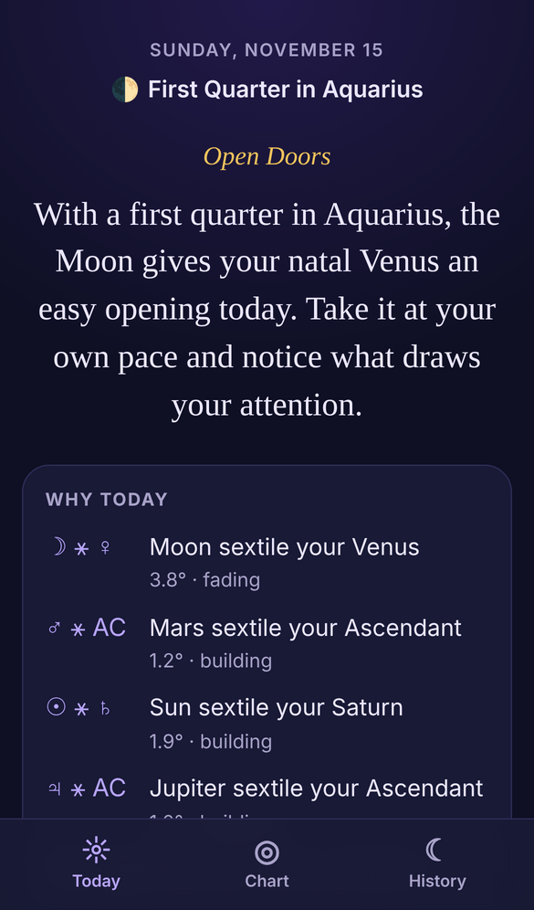
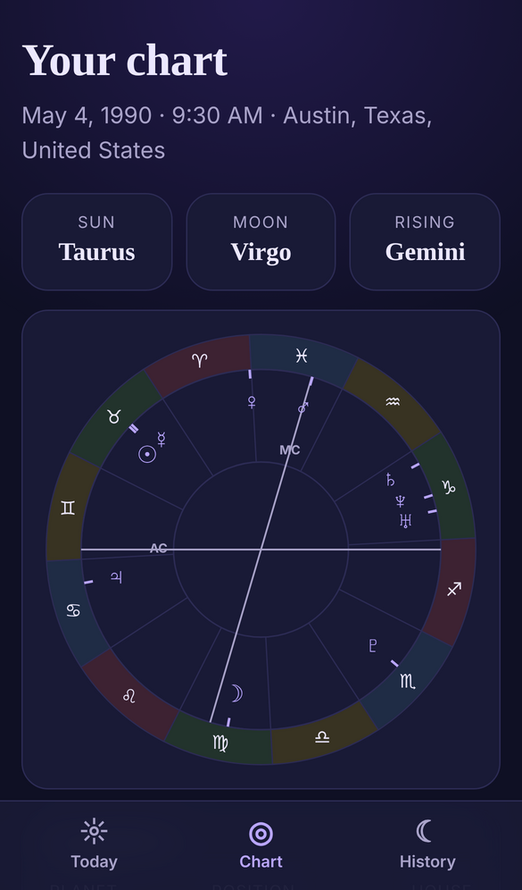
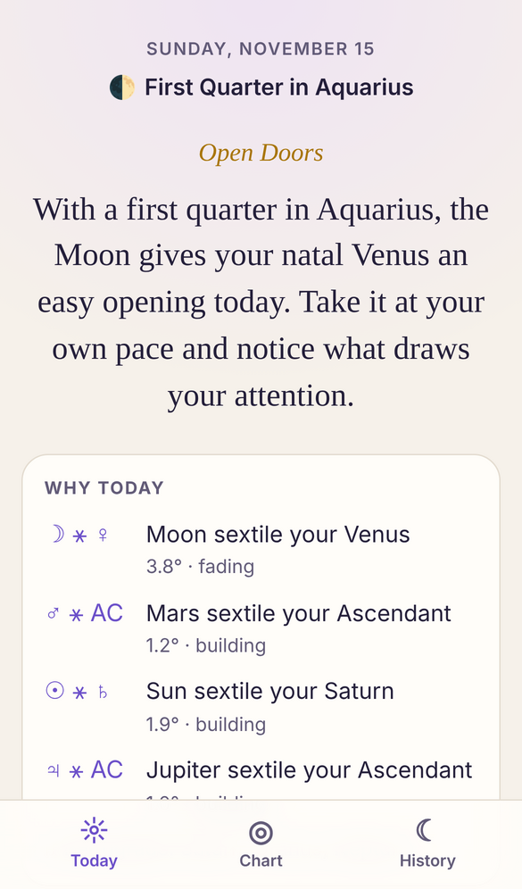

# ✦ Skycast

**A daily horoscope from my real birth chart and my local weather.**

Every morning Skycast calculates where the planets actually are, finds how they line up with my natal chart, checks the forecast for my city, and turns that into a 2–3 sentence reading. It lives on my iPhone home screen like an app.

I can add other people too: each gets their own chart, their own city's weather and their own daily reading, and I can send them a private link that shows only theirs.

| Today | Chart | Light mode |
|---|---|---|
|  |  |  |

<sub>Screenshots use sample birth details. These show the built-in reading from a run without an API key and with the weather service rate-limited, so you can see how the app degrades.</sub>

## How it works

```
birth date/time/place ──► natal chart ─┐
                                       ├─► today's transits ─┐
today at local noon ────► sky now ─────┘                     ├─► facts ─► Claude ─► 2–3 sentences
home city ──────────────► forecast (Open-Meteo) ─────────────┘            │
                                                                          └─► checked, or a built-in reading
```

1. **The chart is calculated, not looked up.** Planet positions come from [astronomy-engine](https://github.com/cosinekitty/astronomy) as geocentric longitudes on the true ecliptic of date (the tropical zodiac). The Ascendant and Midheaven are computed from sidereal time, latitude and the obliquity of the ecliptic. Houses are whole-sign.
2. **Transits are scored.** For each of today's planets against each natal point, Skycast looks for conjunctions, sextiles, squares, trines and oppositions within a per-planet orb. The Moon gets a wide orb because it moves about 13° a day; Pluto gets a tight one. Each aspect is marked applying or separating, and scored by how much it colours a single day.
3. **The weather is real.** One forecast call per day for the home city: conditions, high/low, rain chance, wind, sunrise and sunset.
4. **Claude only writes.** It receives the facts (the big three, the Moon's sign and phase, the top three transits, retrogrades, the forecast) and is told to use nothing else. The output is a typed Pydantic model, and code checks it is 2–3 sentences before it is shown.
5. **One reading per day**, saved, so every visit that day shows the same reading and a history builds up.

## Design decisions

- **Astronomy is tested against astronomy.** The Sun must sit at 0° Aries at each March equinox and 0° Cancer at the June solstice. The Ascendant is checked with an *independent* calculation: convert it to altitude and azimuth and confirm it lies on the eastern horizon. The Midheaven must lie on the meridian. Both are tested at four cities in both hemispheres and at the equator. Mars's 2024–25 retrograde is detected on the right dates.
- **Historical time zones.** A birth time is local time in the birthplace. It is converted to UTC with that place's IANA zone via `zoneinfo`, so daylight saving in the birth year is handled correctly (9:30 in Austin in May 1990 is 14:30 UTC).
- **Birth details stay private.** They are entered on a setup screen behind the app password and stored in my own database, never in the repo. The AI receives chart placements ("Sun in Taurus"), never the birth date, time or place, and a test checks this.
- **Everything degrades gracefully.** No API key, an API error, an output that fails the checks, or a weather outage all still produce a reading, built from the same facts by a template. Every day logs one `[horoscope]` line saying which path it took.
- **Place search that understands "Austin, TX".** The geocoder matches only on the city name, so Skycast splits off the state or country (expanding US state abbreviations) and ranks matches with it, then removes duplicates.
- **Private share links, stored as hashes.** A link is 24 random bytes. Only its SHA-256 hash goes in the database, so the database can't reveal the link. It's shown once, can be replaced or turned off, and opens only that person's pages. Shared pages send `noindex` and `Referrer-Policy: no-referrer`, and a wrong, old or turned-off link gets the same 404.
- **A safe schema upgrade.** Skycast started with a single person. On start-up it copies that profile and its readings into the multi-person tables once, leaving the old tables untouched. This is tested on SQLite and against real Postgres with tables created by the previous version's code.
- **One owner, simple auth.** One password from an environment variable, compared in constant time, with a signed session cookie that lasts a year so the home-screen app stays signed in.

## Stack

| | |
|---|---|
| Web | FastAPI, Jinja2 templates, plain CSS (light and dark), installable PWA |
| Astronomy | astronomy-engine |
| Data | SQLAlchemy 2: Postgres (Neon) in production, SQLite locally |
| AI | Claude via the Anthropic Python SDK, structured output with Pydantic |
| Weather | Open-Meteo forecast and geocoding APIs (free, no key) |
| Tooling | uv, pytest, ruff, GitHub Actions |

## Running it

```bash
uv sync
uv run uvicorn main:app --reload     # http://localhost:8000
uv run pytest
```

Locally, with no `APP_PASSWORD`, the login screen is skipped, and data goes to `./skycast.db`. See [`.env.example`](.env.example) for the production settings: `APP_PASSWORD`, `SESSION_SECRET`, `DATABASE_URL` and `ANTHROPIC_API_KEY`.

## Limitations

- Whole-sign houses only; no Placidus.
- Weather comes from Open-Meteo's free tier, which limits requests per IP address. Shared hosting IPs can hit that limit, in which case the reading goes ahead without weather.
- Transit orbs and weights are my own choices, not a standard.
